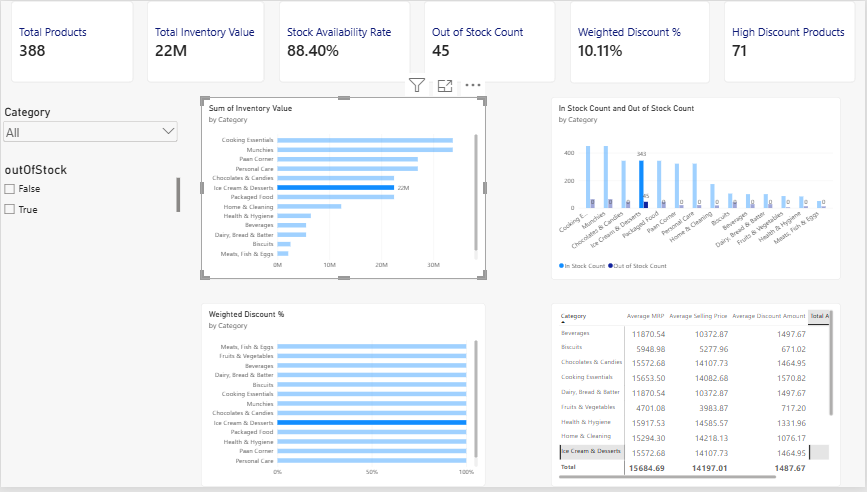

# Retail Inventory & Discount Performance Dashboard

**🌟 Project Overview**

The Retail Inventory & Discount Performance Dashboard is a Power BI data analytics project designed to analyze product inventory value, stock availability, out-of-stock rates, and discount patterns across retail and grocery categories.

The dashboard transforms raw product catalog and pricing data into an interactive visual report that helps users monitor inventory health, compare category-level stock value, track stock availability, and evaluate discounting trends[cite: 5].

Interactive slicers allow users to filter the dashboard by `Category` and `outOfStock` (`False` / `True`), making it easier to investigate specific product segments and stock statuses[cite: 5].

**📊 Business Problem**

Retail and quick-commerce businesses need clear visibility into how much capital is tied up in inventory, which categories experience stockouts, and how discounts impact product pricing[cite: 5].

Analyzing raw catalog and pricing data manually makes it difficult to spot out-of-stock bottlenecks, compare average MRP against selling prices, or identify heavily discounted items across multiple categories[cite: 5].

This project addresses that challenge by presenting key inventory metrics and interactive visualizations in a single dashboard[cite: 5].

**🎯 Key Objectives**

1. Monitor overall catalog size, inventory value, availability, and discount metrics using key performance indicators (KPIs).
2. Compare total inventory value (`Sum of Inventory Value`) across product categories (`Cooking Essentials`, `Munchies`, `Paan Corner`, `Personal Care`, `Chocolates & Candies`, `Ice Cream & Desserts`, `Packaged Food`, `Home & Cleaning`, `Health & Hygiene`, `Beverages`, `Dairy, Bread & Batter`, `Biscuits`, `Meats, Fish & Eggs`).
3. Track `In Stock Count` versus `Out of Stock Count` across categories.
4. Analyze `Weighted Discount %` by category and identify `High Discount Products`.
5. Compare `Average MRP`, `Average Selling Price`, and `Average Discount Amount` by category in a structured summary table.
6. Enable interactive analysis using Power BI slicers (`Category` and `outOfStock`)[cite: 5].

**📁 Data Source**

**Source:** Retail / Grocery Product Inventory & Pricing Dataset (included in the Power BI workbook)[cite: 5].

**📝 Tools and Technologies**

1. **Microsoft Power BI** - Data preparation, data modeling, DAX calculations, KPI cards, interactive visuals, slicers, and dashboard design.
2. **DAX Measures** - Calculation of total products, total inventory value, stock availability rate, out-of-stock count, weighted discount percentage, high discount product count, and average pricing metrics.
3. **Power BI Visualizations** - KPI cards, horizontal bar charts, clustered column charts, slicers, and a category summary table[cite: 5].

**🚀 Key Performance Indicators (KPIs)**

The dashboard includes six primary KPIs:

1. **Total Products:** 388
2. **Total Inventory Value:** 22M
3. **Stock Availability Rate:** 88.40%
4. **Out of Stock Count:** 45
5. **Weighted Discount %:** 10.11%
6. **High Discount Products:** 71[cite: 5]

**📈 Dashboard Visualizations**

**✅ Conclusion**

The dashboard supports data-driven inventory and pricing decisions by helping businesses monitor stock availability, address out-of-stock gaps in key categories, evaluate discount intensity, and compare average MRP against selling prices to improve overall retail performance[cite: 5].